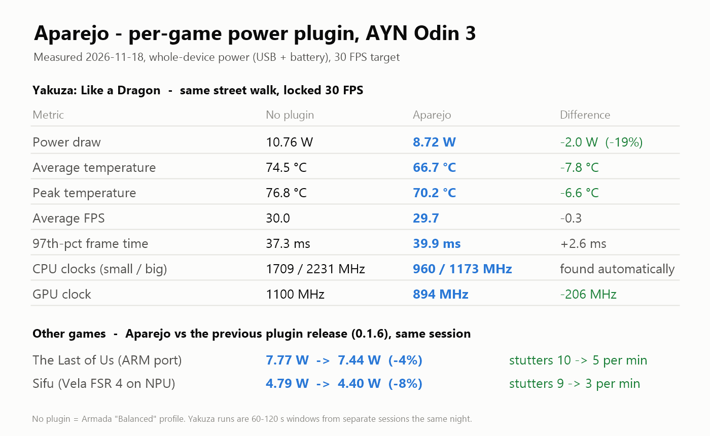

# Aparejo

**Per-game power tuning for the AYN Odin 3 (Armada OS), as a [Decky Loader](https://github.com/SteamDeckHomebrew/decky-loader) plugin.**

Aparejo finds, for each game, the lowest CPU and GPU clocks that still hold the frame rate you want, and remembers
them. You get the same FPS with less power, less heat and a longer battery, without touching a slider every time
you play.



## What it does

- **Per-game profiles.** Your settings are saved for each game and come back on their own when the game starts.
  Outside your profiled games, Armada's own power profile applies as usual.
- **Automatic mode**, pick what is tuned:
  - **Fixed**: CPU and GPU caps you choose by hand.
  - **GPU**: the GPU is kept at the lowest clock that keeps up with the game.
  - **CPU**: the CPU is lowered until the FPS target just holds.
  - **CPU + GPU**: both together (saves the most).
- **FPS target** from 0 to 200 FPS. With a target, every step down is checked against the game's real frame times
  and undone if the game gets slower or starts to stutter.
- **FPS lock**, so the game runs exactly at the target:
  - **Steam** – Steam's own frame limiter (gamescope), switched on for the game and restored when it closes.
  - **MangoHud** – an invisible MangoHud layer inside the game; turns on, off or to a new value with the game running.
  - **Game** – leave it to the game's own limiter.
- **Learning.** The clocks found are remembered per game, so the next session starts right there.
- **Live status** in the panel: FPS, target, CPU and GPU clocks and GPU load.
- **10 languages** (English, Português, Español, Français, Deutsch, Italiano, Русский, 日本語, 한국어, 中文),
  picked from Steam's language.

## Measured results

Whole-device power (USB + battery), 30 FPS target, same scene and save in each comparison, AYN Odin 3, 2026-11-18.

**Yakuza: Like a Dragon** – walking the same street, locked 30 FPS

| | No plugin (Armada "Balanced") | Aparejo (CPU + GPU) | Difference |
|---|---|---|---|
| Power draw | 10.76 W | **8.72 W** | **−2.0 W (−19 %)** |
| Average temperature | 74.5 °C | **66.7 °C** | **−7.8 °C** |
| Peak temperature | 76.8 °C | **70.2 °C** | **−6.6 °C** |
| Average FPS | 30.0 | 29.7 | −0.3 |
| 97th-percentile frame time | 37.3 ms | 39.9 ms | +2.6 ms |
| CPU clocks (small / big) | 1709 / 2231 MHz | 960 / 1173 MHz | found automatically |
| GPU clock | 1100 MHz | 894 MHz | −206 MHz |

The two Yakuza runs are 60–120 s windows from separate sessions on the same night.

**Against the previous release (0.1.6), same session**

| Game | Power 0.1.6 → now | Frame pacing |
|---|---|---|
| Yakuza: Like a Dragon | 9.20 W → 8.72 W (−5 %), −4.1 °C | same |
| The Last of Us (ARM port) | 7.77 W → 7.44 W (−4 %) | slow frames 10 → 5 per minute |
| Sifu (Vela FSR 4 on the NPU) | 4.79 W → 4.40 W (−8 %) | slow frames 9 → 3 per minute |

FPS lock (Yakuza, fixed clocks, 30 FPS): the game's own cap 9.71 W, MangoHud 9.56 W, same frame pacing.

## How it works

- **Frame times.** Aparejo reads the frame times gamescope already sends to the Steam performance overlay
  (through a kernel tracepoint on its message queue, without taking the messages away, so the overlay keeps working).
- **GPU.** The GPU clock is locked (min = max) at the lowest step where its average load stays around 85 %.
  It goes up at once when load rises and down one step at a time; each step down is checked against the frames a few
  seconds later and undone, with a temporary floor, if the game got slower or hitched. A per-clock hitch counter and a
  guard against the driver's short fence-deadline boosts keep it from bouncing.
- **CPU.** After the GPU settles, the CPU frequency caps are lowered one step at a time (small cores first, then big
  cores), each step judged on 8 s of frames. A step that costs FPS or stutter is undone and becomes that cluster's
  floor. While holding, the FPS is checked every second: a slip raises the CPU at once; a big drop goes back to the
  ceilings and searches again. The search is retried later only in normal-weight scenes (never in pause menus).
- **Target relative to the game.** If a game cannot reach the target even at full clocks, Aparejo aims at what the
  game actually does instead, so it still saves power without making it slower.
- **Clean exit.** When the game closes, Armada's power profile and Steam's limiter settings are put back.

## Requirements

- AYN Odin 3 with **Armada OS** in Steam game mode (gamescope). Other Snapdragon handhelds with the same
  sysfs layout may work but are untested.
- Decky Loader 3.x. The plugin runs with root (`"flags": ["root"]`) to read frame times and set clocks.

## Install

1. In Decky's settings, turn on *Developer mode*.
2. In *Developer*, use *Install plugin from URL* with the link of `Aparejo-v0.2.7.zip` from the
   [latest release](../../releases/latest).

Or by hand, from a terminal on the device:

```bash
unzip Aparejo-v0.2.7.zip -d /tmp/aparejo
sudo cp -r /tmp/aparejo/Aparejo ~/homebrew/plugins/
sudo systemctl restart plugin_loader
```

## Use

1. Start a game and open the Aparejo panel in the quick access menu.
2. Turn on **Own settings**, choose **Automatic → CPU + GPU** and an **FPS target** (30 is a good start).
3. Pick how to **lock the FPS**: Steam, MangoHud or the game itself.
4. Play. In a minute or two the status box shows *stable* and the clocks it found.

The CPU and GPU sliders below are the **ceilings and floor** the automatic mode works within. Keep the CPU ceilings
at Armada's defaults: higher ceilings only make the search start higher.

## Known limitations

- Steam's frame limiter does not hold some native ARM ports (for example The Last of Us port); use MangoHud there.
- MangoHud is added to a game's launch options when its profile is made; it works from the next launch of that game.
- Under Steam's limiter the frame-time spikes gamescope reports are not trusted, so stutter detection relies on FPS
  and the 97th percentile there.
- Tested on one device (AYN Odin 3, Armada OS). Reports from other setups are welcome.

## License

MIT
